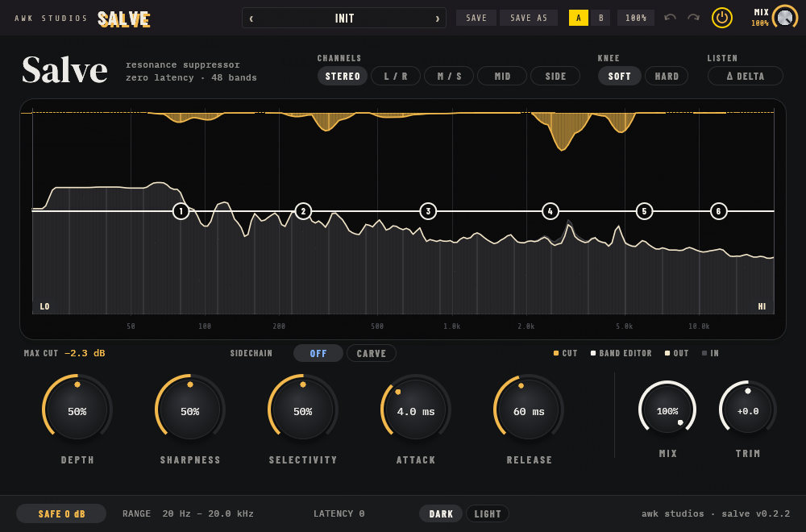

# SALVE

**Low-CPU, zero-latency resonance suppressor with sidechain CARVE.**



SALVE finds harsh or boomy resonances as they happen and dips just those, using 48 dynamic bells. A six-node band editor sets how hard each part of the spectrum is treated.

## Features

- **DEPTH, SHARPNESS, SELECTIVITY, ATTACK, RELEASE**, plus SOFT / HARD.
- **Band editor:** six draggable nodes weight the treatment by frequency. LO / HI limit the range.
- **Channels:** STEREO (linked), L / R, M / S, MID or SIDE.
- **CARVE:** route a kick or vocal into the sidechain, and SALVE cuts this track only where the key is loud.
- **DELTA:** hear only what's being taken out.
- Zero latency. MIX, TRIM and SAFE.
- 25 factory presets.

## Install

Windows 64-bit, VST3. Built and tested in FL Studio.

1. Download `Salve-v0.2.2-win64.zip` from [Releases](../../releases/latest).
2. Copy `Salve.vst3` into `C:\Program Files\Common Files\VST3\`.
3. Copy the files in `presets` into `Documents\Awknode\Presets\Salve\` (create the folder if it doesn't exist).
4. Rescan plugins in your DAW.

## Using it

Every awk studios plugin has the same top strip: preset browser, A/B, undo/redo, power (bypass) and a global MIX. Knobs drag up and down (hold Ctrl or Shift for fine control), scroll to nudge, and double-click to reset. **SAFE** in the footer is an output limiter that keeps the plugin from going over 0 dBFS; it's on by default.

The full control reference is in the **[manual](docs/MANUAL.md)**.

## Build from source

You'll need Docker. Clone this repo next to the [nice-plug-awk](https://github.com/awknode/nice-plug-awk) framework fork, then run the build script:

```sh
git clone https://github.com/awknode/salve
git clone -b awk-studios https://github.com/awknode/nice-plug-awk
cd salve && ./build.sh
```

The plugin lands in `target/bundled/Salve.vst3`.

## License

GPL-3.0. See [LICENSE](LICENSE). Built with [nice-plug](https://codeberg.org/RustAudio/nice-plug).

---

More awk studios plugins: [VISE](https://github.com/awknode/vise) · [HOIST](https://github.com/awknode/hoist) · [KILN](https://github.com/awknode/kiln) · [PATINA](https://github.com/awknode/patina) · [CHOPSHOP](https://github.com/awknode/chopshop) · [THROWBACK](https://github.com/awknode/throwback) · [THROW FX](https://github.com/awknode/throw-fx) · [KICKNULL](https://github.com/awknode/kicknull) · [ALLEYVERB](https://github.com/awknode/alleyverb) · [WAVETAG](https://github.com/awknode/wavetag) · [dBCOMP](https://github.com/awknode/dbcomp) · [dBVOX](https://github.com/awknode/dbvox)
